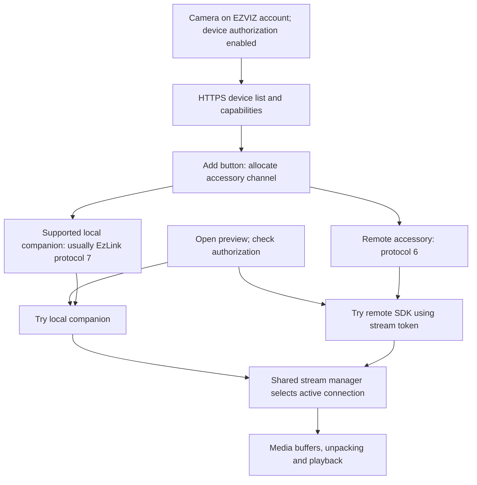

# Additional EZVIZ cameras on the indoor screen

Analysis date: 2026-10-17. Scope: the indoor screen's shipped `ezapp`, its GUI
resources, and existing sanitized configuration findings. This is static
analysis; no additional camera was paired and no live cloud request was sent.

Artifact SHA-256:
`a8ef273c1d60213fcae8ae7567c0d2cb199162bc269766f0cade5e86045a7377`.
Provider: Ghidra 12.1.4 through REA. Function names below are recovered from log
strings; they are not a retained source symbol table. Addresses are the Ghidra
analysis addresses, not file offsets.

## Result

The screen implements an account-authorized camera viewer with both remote and
local connection paths. A camera added through this UI is registered as a remote
accessory, and supported models also receive a local companion, called a
"buddy" in the code. Preview can initiate both paths; a stream manager retains
the connection that delivers data and closes the competing path.

Consequently, cloud authorization does not establish that every video packet
passes through a cloud relay. Conversely, having a local media path does not
establish indefinite operation without EZVIZ authorization or token refresh.



## 1. What the Add device page expects

The packaged resource
`firmware/gui_res/sysres/conf/gui_acsy_add_page.json` contains separate states
for no devices, Wi-Fi disconnected, and authorization missing. Its text tells
the user to add the camera to the EZVIZ application first and to enable device
authorization in Device Settings -> More. Device cards offer Add/Delete and an
offline indicator. This page contains no manual RTSP URL or IP/password form.

Code confirms the authorization requirement:

- `gui_create_acsy_add_page`, `0x0bfbd4`, loads that exact JSON resource.
- `_create_new_card`, `0x0bf09c`, attaches the card's Add button to `0x0c006c`.
- `_add_btn_click_event_cb`, `0x0c006c`, starts the asynchronous add operation.
- `_do_add_single_acsy`, `0x0c013c`, checks network/authentication state, rejects
  duplicate devices, reserves a free channel, and calls `accessory_create_ex`.

The firmware also has text asking for the IPC and screen to be on the same
account. Some share states are filtered in the cloud-list parser, so this
analysis does not establish that every kind of shared camera is accepted.

## 2. Getting the list and capabilities

`_request_remote_accessory_list`, `0x254c78`, sends an HTTPS GET with a
`dev_token` header. The route helper at `0x75e928` supplies:

```text
/v3/userdevices/resources/category
```

The query includes `devTypes`, `limit=100`, `offset`, `concise=true`, and the
filters `STATUS,WIFI,TTS,SPECIAL_DEVICE,CONCISION_STATUS`. The limit is a page
size, not the screen's maximum camera count.

`_parse_accessory_list_response`, `0x254668`, parses `deviceInfos`,
`resourceInfos`, and pagination through `page.hasNext`. It initializes remote
entries with protocol type 6. Related parsers recover:

- serial, model/category, firmware version and display name;
- online status and camera/resource identifiers;
- encryption status and password/digest metadata;
- talk, PTZ, alarm-light and multichannel capability flags;
- remote service addressing, including VTM information.

This explains why cameras appear by name and why different models expose
different preview controls. Presence of a generic protocol implementation is
not evidence that every model is accepted by this product's filters.

The discovery subsystem also collects local devices. `disco_core_add_result`,
`0x24ea40`, removes duplicate remote entries when a local result for the same
device exists and prefers an EzLink 3.0 discovery record over an HCNet record.

## 3. What adding a camera creates

`accessory_create_ex`, `0x26a1a8`, registers the main accessory as protocol 6,
the remote implementation. For eligible additional channels, it also creates a
companion record with protocol 7; a NAS product branch uses protocol 1 instead.
`_register_accessory_buddy`, `0x25b714`, explicitly excludes certain product
categories from EzLink support.

Thus an added camera is not necessarily just another entry in `ezlink_cfg`:
the main camera record and its remote capabilities live in the accessory
subsystem, with an optional local companion. This corrects the broader
assumption in the older private pairing note.

The image additionally implements cloud relationship management:

| Operation | HTTPS endpoint |
|---|---|
| Query resources linked to the screen | `GET /v3/userdevices/resources/related?relatedDeviceSerial=...` |
| Add a resource relationship | `POST /v3/devices/authenticate/relate` |
| Remove a resource relationship | `DELETE /v3/devices/authenticate/relate?relatedDeviceSerial=...&resourceIds=...` |

The add-relationship routine constructs a `list` of objects containing
`deviceCategory`, `deviceSerial`, `resourceId`, `deviceGroup`, `relatedSerial`,
`localIndex`, and `resourceName`. The related-resource response parser can
restore missing accessories automatically into free channels.

The HTTP implementations and restoration path are confirmed. A complete direct
call chain from the current Add button to the relationship POST was not
established; do not assume that this build invokes that POST on every add.

## 4. Encryption key and authorization token are separate

For cameras on the same account, `accessory_create_ex` attempts to retrieve the
camera's stream encryption key and saves it through `accessory_set_encrypt_key`
with source selector 2. `_check_stream_encrypt`, `0x268ee0`, can repeat this
retrieval after key validation fails.

The key request is implemented by `_request_remote_accessory_encrypt_key`,
`0x250e10`:

```text
GET https://<service>/v3/devices/<camera-serial>/0/encryptkey
dev_token: <device authorization token>
```

Its parser extracts `encryptKey`. Response code 403 is explicitly recognized as
forbidden. It logs that reauthorization is needed and fails the operation; the
full subsequent reauthorization state transition was not traced here.

Separately, `_get_stream_token_form_server`, `0x2da5f8`, obtains a batch of
short-lived stream authorization tokens:

```text
POST https://<service>/v3/authtoken/user/token/get?count=20
dev_token: <device authorization token>
```

`_parse_stream_token_response`, `0x2d6df0`, reads `tokenArray` and `expiredTime`,
converts the expiry from milliseconds to seconds, and queues the tokens.
`remote_get_stream_token`, `0x2e5a38`, allocates one from this queue for a session.

These are distinct roles: account/device authorization permits API access, a
stream token authorizes a session, and `encryptKey` supplies camera encryption
material. None should be assumed to equal the AES key used by the separate
screen-to-door-station control protocol. This pass did not establish the exact
media cipher or KDF used for every supported external camera.

## 5. How preview selects a connection

`accessory_open_stream`, `0x2621cc`, first checks the screen's authorization flag
for additional camera channels. It then calls `_accessory_open_stream_buddy`,
`0x25bfbc`, which requires an existing online companion. That call starts an
asynchronous local open operation.

For video, a successful start of the local attempt does not skip the remote
attempt: the function can also start the main accessory's open operation. Talk
has an explicit exception: if local talk succeeds, it returns without starting
remote talk.

`stream_sdk_data_proc`, `0x282e84`, distinguishes protocol 6 data from local
companion data and calls `stream_set_connect_mode`, `0x282cb4`, with mode 1
(remote) or 2 (local). If a different mode is already active, it posts a
`close_stream_topic` message. `_close_stream_notify`, `0x25a68c`, closes the
competing local or remote stream according to that message.

This supports an asynchronous race between available connection paths, rather
than a simple fixed rule that all additional-camera video uses RTSP or all
video uses a cloud relay. The exact winner for a particular camera requires
runtime observation.

### Remote SDK path

```text
remote_open_stream                   0x2d26cc
  -> _remote_stream_open_thread      0x2cfc68
  -> remote_sdk_start_stream         0x2ed4d8
  -> allocate stream token           0x2e5a38
  -> ez_stream_start                 0x6d6c00
  -> preview_stream_start            0x6d78b0
  -> C++ ClientApi::start            0x6dd358
```

The start request includes the camera serial, stream selection, remote service
host/port and authorization token. The SDK returns a session ID and delivers
preview data through `_stream_sdk_preview_callback`, `0x2ed274`, to the shared
stream manager. That manager writes data into media buffers for unpacking and
playback.

The function's label "remote" names this SDK branch. This pass did not trace
its entire internal connection negotiation, so it does not prove whether a
specific session uses direct connectivity, NAT traversal, or a relay.

### Local protocols and RTSP

The local companion in the additional-camera creation path normally uses the
EzLink implementation. Other firmware paths support HCNet and an RTSP client.
`accessory_stream_open_rtsp`, `0x2eeedc`, binds the selected interface and starts
the RTSP client using configured address, credentials and port.

That RTSP implementation was confirmed, but an explicit caller from the
additional-camera creation path was not resolved in this pass. It must not be
presented as the universal transport for cameras added through the account UI.
Likewise, MPEG-PS unpacking alone does not establish CPD7 on port 9020.

## 6. Practical consequences and remaining questions

A follow-up [configuration-only RTSP check](rtsp-config-only-check.md) found
that startup forces additional channels to protocol 6 and creates a local
companion separately. Appending IP/login/password and changing `proto_type`
therefore does not establish a way to add an arbitrary RTSP stream.

- A supported EZVIZ camera should first be available to the authorized account;
  this UI's ordinary workflow does not accept an arbitrary RTSP URL.
- Discovery and local-companion code allow direct local media, while account
  permission and token handling remain cloud-dependent parts of the design.
- `accessory_open_stream` checks authorization even before attempting the local
  companion for additional channels. A local stream therefore does not prove
  an authorization bypass or permanent offline operation.
- A matching manufacturer alone is insufficient to guarantee compatibility;
  category filters and per-model capabilities are checked.
- Maximum camera count is taken from runtime capability data. Neither the
  100-item list page, 20-token batch, 64-item relationship request nor four home
  dashboard cards establishes that limit.

To finish runtime verification, capture the screen's home-network interface
during one add and one preview. Correlate `proto_type`, session ID,
`stream_set_connect_mode`, and `_close_stream_notify` logs with camera-directed
and Internet-directed connections. Repeat preview with WAN unavailable after
authorization and then after token expiry to distinguish local media from
cloud authorization dependencies. No such experiment was performed here.

## Evidence ledger

All entries below are observations of shipped code, not observed execution.
Confidence is high for the explicit checks, API construction and dispatch;
runtime route selection and model compatibility remain unverified.

| Finding | Principal REA evidence |
|---|---|
| Add-button operation and auth checks | `ev_78a6b778327c9360c8144e6929396a54537a4ca350b62df0550e0816d7291703` |
| Device-list HTTPS request | `ev_b19c437f053f56e40223ebfb031b2e7b9923c6e1a23aa083c422b7f6454b8995` |
| Category route | `ev_26bb358793d7393c410f99fd20d9112ed2e5ecffdef46faea478d90752c9a4a5` |
| List parsing and protocol 6 | `ev_02a20c704cde696491a139eff0dac603bebdad1658b0ef52b545882151c8a72a` |
| Local discovery deduplication | `ev_10853dd9e398012154d957f4d752dc586287c0bc1421f9e125340071168f605e` |
| Remote record plus local companion creation | `ev_c55614ad537cb5913827e11e300c8f7ee58ff0a23d0b5306e2f084c2af9882e1` |
| Relationship POST implementation | `ev_413e84e1701daa3da7c3b794fea557e2cdd0eb768a7b4b61158a41ea4e0c81fc` |
| Related-resource restoration | `ev_cf5fbfdc7570734c3c8643116c6c0e6ab767069868ef752f0918fc75960eab41` |
| Camera encryption-key request | `ev_7b884a1f337b5b0a5a401186171bf1a54433c78ec546915cf4e17345f98c8944` |
| Stream-token request and expiry parsing | `ev_e0f9a975ca9c37c43132280f83e19fc82ec426beee84f81b4e0748639028e729`, `ev_424f0112234c17c257c6a539c5418b5f75b5f3a36ee8cd0973c5514a8babcba6` |
| Local and remote preview attempts | `ev_359cf0d1b92047457b60d44e7d92d1fa0c198a283aebfbda0e9a88081301bab5` |
| Connection-mode arbitration | `ev_544d01ac37c9d86a56c58ac5e8ce6b826b10b2df4d65e00962e0d1d89f070f44`, `ev_19e8a436fe073e90d7d111f14c0ef22fe9a10d01d551f21b2732e8586fe9c014`, `ev_6f4b3e1d1d53313b2ee3a82ca7d92d28346b6067e214b0673f9d812c3badc148` |
| Remote stream startup | `ev_d5dbd151106039385428e646bf318de72cca0df8943d7619c779287274f8e490` |
| Remote SDK preview callback | `ev_569347c93ed99669b52ba00301285a12df64e48880890aebf9c282661878d644` |

The session's full static evidence was exported to
`/tmp/hp5-additional-cameras-evidence-20261017.json` for local inspection. That
temporary file is not part of this repository. No actual account tokens,
camera encryption keys or device passwords are included in this report.
